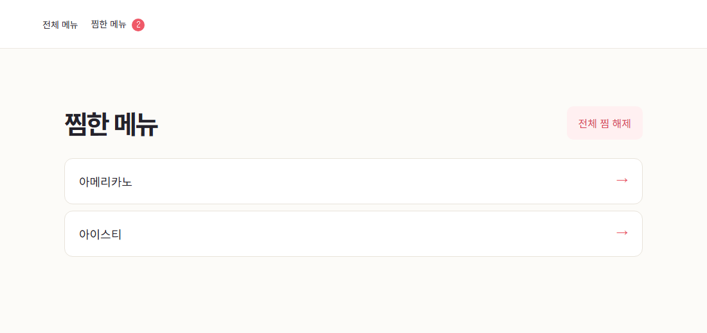
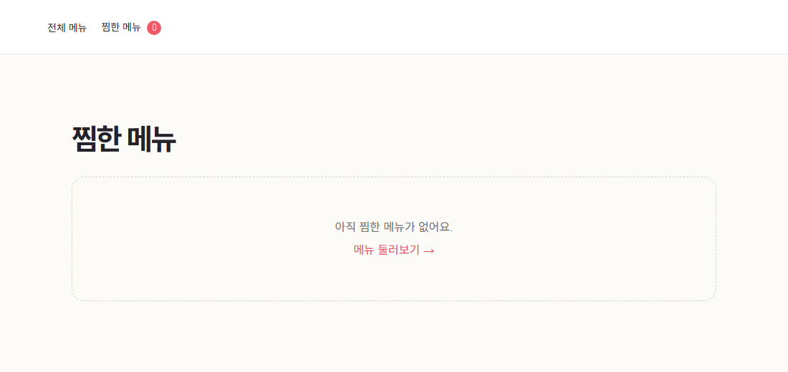

# 4주차 과제 — 전체 찜 해제

찜한 메뉴가 있으면 목록 오른쪽에 **전체 찜 해제** 버튼이 표시됩니다. 버튼을 누르면 Zustand의 `clearFavorites`가 찜 목록을 비우고, 상단의 찜 개수가 0으로 바뀝니다.

## 실행

```sh
npm ci
npm run dev
```

## 확인 방법

1. 전체 메뉴에서 서로 다른 음료 두 개를 열고 각각 **찜하기**를 누릅니다.
2. 상단의 **찜한 메뉴**를 열어 목록의 두 항목과 **전체 찜 해제** 버튼을 확인합니다.
3. 버튼을 누른 뒤 상단에 0이 표시되고 본문에 **아직 찜한 메뉴가 없어요.**가 보이는지 확인합니다.

## 실행 화면

### 전체 찜 해제 버튼



### 전체 찜 해제 완료


